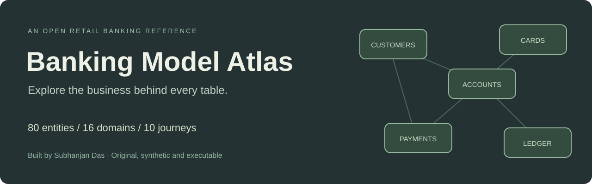
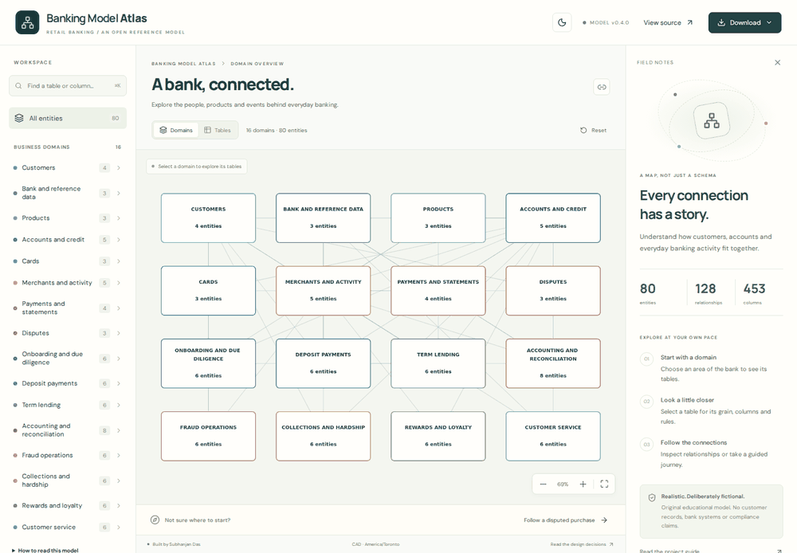
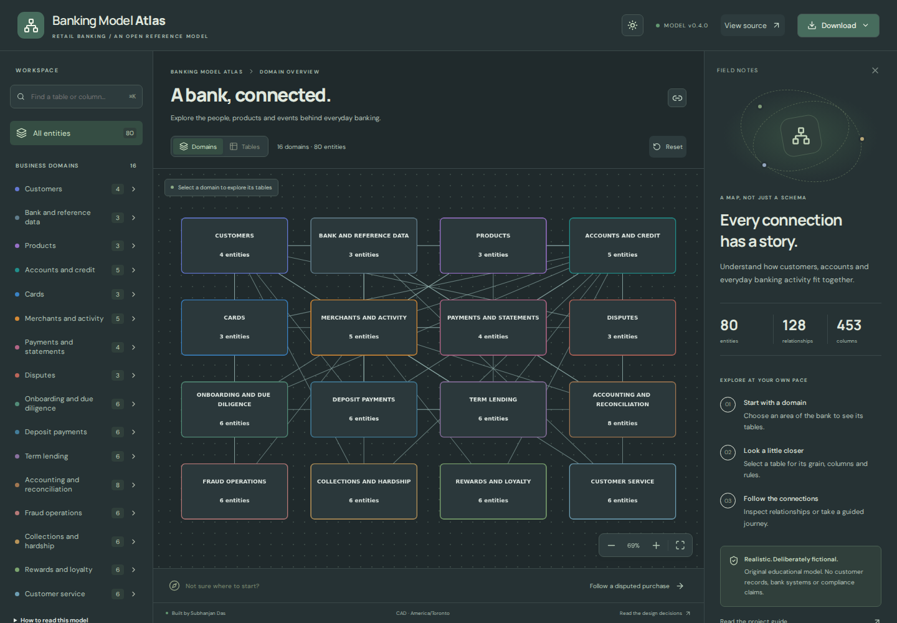
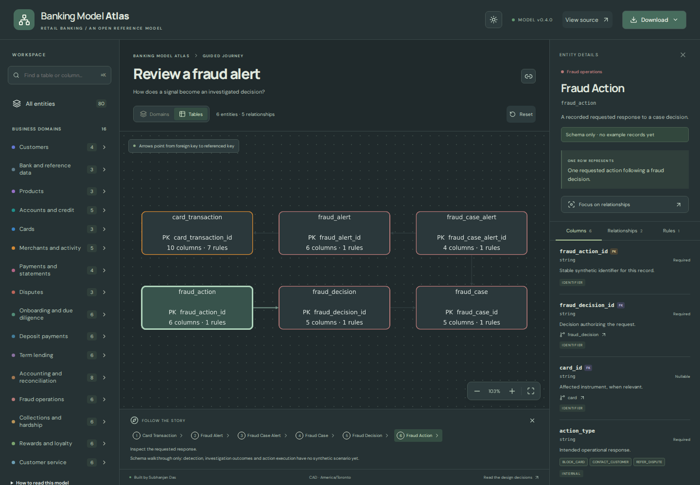
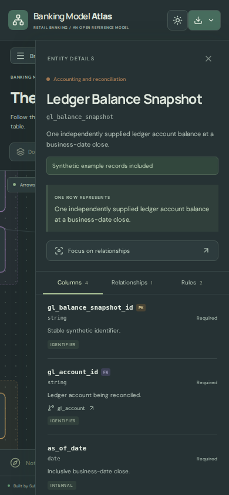
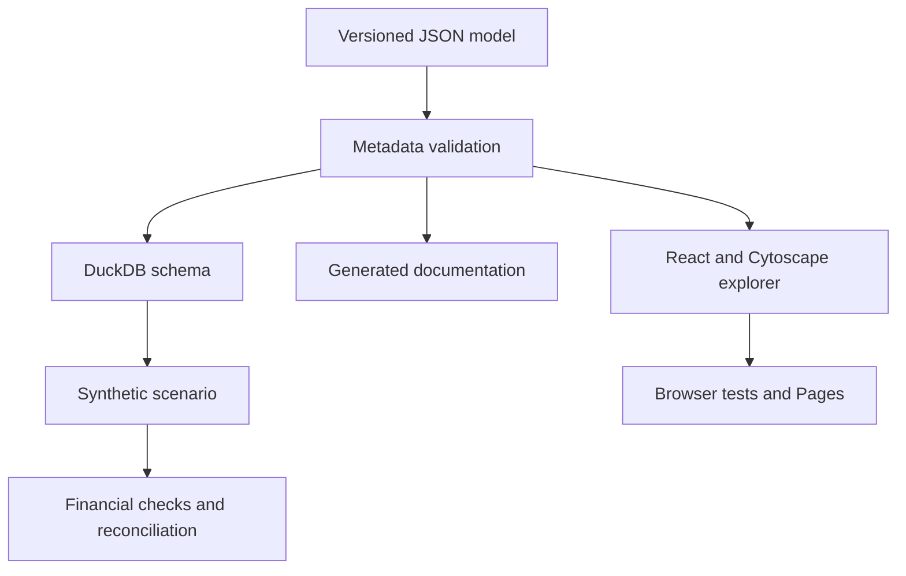

<div align="center">



**A banking data model you can explore, run and explain.**

[**Open the live explorer ↗**](https://subhanjandas.github.io/banking-model-atlas/) · [Five-minute interview demo](docs/INTERVIEW_GUIDE.md) · [Run the SQL example](docs/SQL_AND_DEMO.md)

[](https://github.com/subhanjandas/banking-model-atlas/actions/workflows/explorer.yml)
[](https://github.com/subhanjandas/banking-model-atlas/actions/workflows/validate.yml)
[](LICENSE)

Built by **[Subhanjan Das](https://github.com/subhanjandas)** · Application **1.0.0** · Model **0.4.0**

</div>

## See it in action

<a href="https://subhanjandas.github.io/banking-model-atlas/"></a>

*Actual captures of the public website, assembled into a looping tour. [Capture provenance](docs/assets/provenance.json). Prefer a still image? Use the screenshots below.*

A customer disputes a purchase. Which account, card, merchant, transaction and case belong together? Atlas makes those connections visible—and explains what each record means.

| Explore | Understand | Take it with you |
|---|---|---|
| Domain filters, table/column search, focused neighbours | Grain, keys, relationships, rule specifications and coverage labels | Model JSON, Markdown dictionary, DuckDB schema and graph PNG |
| Ten guided business journeys | Beginner guidance and step explanations | Shareable links to a table, column or journey |
| Light and muted Dusk themes | Synthetic examples clearly separated from schema-only extensions | Static website; no login or cloud account needed |

## What model is this?

An **original, operationally oriented relational reference model** for Maple Harbour Bank, a fictional Canadian retail bank. The JSON metadata drives the graph, documentation and executable DuckDB schema.

It is useful for learning, design discussions and demonstrating data-modeling decisions. It is not an actual bank's schema, a dimensional warehouse, a complete core-banking application or a compliance implementation.

| Model breadth | Executable depth |
|---|---|
| **80 entities · 16 domains · 453 columns** | All **80 tables** created in DuckDB |
| **128 relationships · 46 rule specifications** | **175 synthetic records** across **49 tables** |
| **10 connected journeys** | **19 SQL checks** plus opening-to-closing ledger reconciliation |

**Coverage matters:** the four newest domains—fraud, collections, rewards and customer service—are schema-only extensions. Their structures are validated; their operational workflows have no data fixtures yet. The inspector labels this distinction. [Exact check coverage →](docs/VALIDATION_COVERAGE.md)

## A closer look

| Light overview | Dusk overview |
|---|---|
|  |  |



*Start with a domain or journey. Select a table for its grain and columns, then follow a relationship. The full graph is an overview; focus mode provides readable detail.*

<details>
<summary><strong>Mobile view</strong></summary>
<br>

</details>

## Follow the business story

| Journey | Question it helps explain |
|---|---|
| [Disputed purchase](https://subhanjandas.github.io/banking-model-atlas/?journey=investigate_disputed_purchase) | Who used the card, what posted, and what is being disputed? |
| [Monthly statement](https://subhanjandas.github.io/banking-model-atlas/?journey=explain_monthly_statement) | Which booked entries explain the closing balance? |
| [Customer onboarding](https://subhanjandas.github.io/banking-model-atlas/?journey=onboard_a_customer) | How are applications and recorded checks connected? |
| [Deposit payment](https://subhanjandas.github.io/banking-model-atlas/?journey=trace_a_deposit_payment) | How does an instruction connect to posting and settlement? |
| [Term-loan funding](https://subhanjandas.github.io/banking-model-atlas/?journey=fund_a_term_loan) | How do a decision, contract, schedule and disbursement differ? |
| [Ledger reconciliation](https://subhanjandas.github.io/banking-model-atlas/?journey=reconcile_to_the_ledger) | Can customer activity be traced to balanced accounting? |
| [Fraud review](https://subhanjandas.github.io/banking-model-atlas/?journey=review_a_fraud_alert) | How does a signal become an investigation and decision? |
| [Collections support](https://subhanjandas.github.io/banking-model-atlas/?journey=support_an_overdue_account) | How do overdue positions, promises and hardship plans differ? |
| [Reward points](https://subhanjandas.github.io/banking-model-atlas/?journey=trace_reward_points) | How should earning, redemption and corrections connect? |
| [Complaint resolution](https://subhanjandas.github.io/banking-model-atlas/?journey=resolve_a_complaint) | How is a concern recorded, investigated and answered? |

The last four journeys explain proposed structures; they are not executed business processes.

## How it works



React + TypeScript + Vite render the interface. Cytoscape handles the graph. Python validates metadata and generates documentation/DDL. DuckDB runs the financial examples. GitHub Actions tests and deploys the static site, then captures the public website.

## Run it yourself

Node.js **22.12+** and Python **3.10+**. No database server or cloud credentials required.

```bash
git clone https://github.com/subhanjandas/banking-model-atlas.git
cd banking-model-atlas
npm ci
npm run dev
```

In a second terminal, run the reproducible data checks:

```bash
python3 -m pip install -r requirements-demo.txt
python3 replay.py
npm test
npm run build
```

### A small SQL example

An empty result means every supplied posted journal balances:

```sql
SELECT j.journal_id,
       SUM(CASE WHEN l.direction = 'DEBIT'
                THEN l.amount ELSE -l.amount END) AS difference
FROM journal j
JOIN journal_line l USING (journal_id)
WHERE j.status = 'POSTED'
GROUP BY j.journal_id
HAVING difference <> 0;
```

To query the actual in-memory fixture from the repository root:

```python
import sys
from pathlib import Path
sys.path.insert(0, "scripts")
from run_demo import database

with database() as db:
    sql = Path("examples/reconciliation.sql").read_text()
    print(db.execute(sql).fetchall())  # [] for the valid fixture
```

A balanced journal can still use the wrong accounts or amounts. That is why the project also compares independently supplied opening/closing snapshots, individual account movements and control-account totals. [See the worked figures →](docs/OPERATIONS.md)

## What did we test?

| Layer | Tests | Examples |
|---|---:|---|
| Metadata | 18 | Broken foreign keys, nullable primary keys, wrong cardinality, disconnected journeys |
| SQL and reconciliation | 30 | Excess refunds, incorrect reversals, invalid transitions, missing mappings, balanced-but-wrong closing balances |
| Explorer logic | 24 | Search, filters, URL state, neighbour focus, all ten journey subgraphs |
| Browser | 10 | Navigation, downloads, mobile overflow, theme persistence, system preference, coverage labels |
| Post-deploy evidence | Separate capture | Opens the public site and saves screenshots with timestamp and commit |

**82 automated tests**, plus post-deploy capture. The workflow badges above show the current run status. [Validation details](docs/VALIDATION.md) · [Reproducible demo report](generated/demo-report.json)

## Decisions worth discussing in an interview

| Decision | Why it matters |
|---|---|
| Separate accounts from cards | Replacing an instrument should not rewrite the financial relationship. |
| Separate authorization from posting | Approval does not guarantee that a transaction settles. |
| Separate disputes from refunds | A claim is not itself a financial adjustment. |
| Append reversal entries | Preserve original postings and an explainable audit trail. |
| Separate customer entries from journals | Principal, interest, cash and customer presentation have different grains. |
| Validate independent snapshots | Detect errors that still leave total debits equal to credits. |
| Label coverage honestly | Model breadth is different from executable business behavior. |

**[Interview guide →](docs/INTERVIEW_GUIDE.md)** includes a 30-second introduction, five-minute walkthrough and questions to prepare for. **[Learning notes →](docs/LEARNINGS.md)** explain the lessons and a real documentation mismatch found during development.

## Find your way around

| Path | What lives there |
|---|---|
| `model/` | Definitions, relationships, business checks and transition matrices |
| `src/` | Explorer, graph adapter, search, URL state and themes |
| `fixtures/` | Synthetic records and independently specified expected balances |
| `scripts/` | Validation, DDL generation, reconciliation and live screenshot capture |
| `generated/` | Reproducible DuckDB schema and demo report |
| `tests/` | Metadata, SQL, graph and browser regression tests |
| `docs/` | Catalogue, dictionary, decisions, operations, interviews and launch notes |

[Entity catalogue](docs/ENTITY_CATALOGUE.md) · [Data dictionary](docs/DATA_DICTIONARY.md) · [Business rules](docs/BUSINESS_RULES.md) · [Design decisions](docs/DECISIONS.md)

## What can improve next?

The portfolio reference release is complete. The highest-value next work is deeper evidence:

- Populate and test the four schema-only domains, starting with reward-point reconciliation.
- Add partial returns, late-arriving corrections and source-ingestion idempotency.
- Validate effective-time ownership and completeness against an independent source feed.
- Add model migrations and a deliberately designed analytical layer.
- Expand accessibility testing and measure larger-graph performance.

[Roadmap and boundaries →](docs/ROADMAP.md). Multicurrency banking, real fraud scoring, regulatory reporting and production bank operations remain outside scope.

## Contribute or share

Found an unclear relationship or a better business example? Open an issue with a synthetic example and the question you want to answer. [Contribution guide](CONTRIBUTING.md) · [Launch plan](docs/LAUNCH.md)

If the explorer helps you learn or explain banking data, a star helps you save it and share it with others.

## Credits and license

Built by **Subhanjan Das**, with AI assistance. All records are synthetic. No employer schemas, internal documents or actual customer data are included.

Inspired by the visual exploration experience of [Databricks Lakehouse Industry Data Models](https://github.com/databricks-industry-solutions/lakehouse-industry-data-models). This is an independent implementation with original modeling choices, no affiliation or endorsement, and no claim of BIAN certification. [Sources and boundaries](docs/SOURCES.md).

[MIT license](LICENSE).
