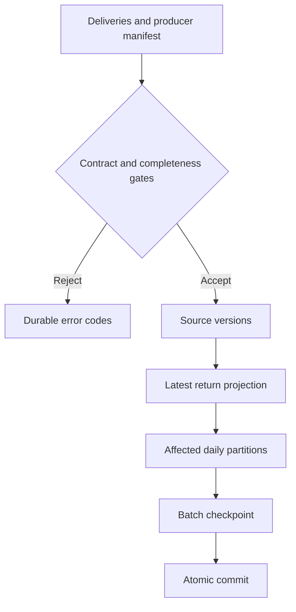

# From source delivery to a published daily total

A correct dashboard is easy to demonstrate with a clean file. The more interesting question is what happens when that file arrives twice, a return is corrected three days later, or a worker disappears halfway through a write.

This lab answers those questions with an actual database, repeatable failure tests and a small analytical model. It runs locally without a cloud account. The [public evidence page](https://subhanjandas.github.io/banking-model-atlas/?page=engineering) displays generated results, not a live API.

## Run the scenario

Use Python 3.12 or newer, from the repository root. The lab itself uses the standard library. The full Atlas replay additionally needs `requirements-demo.txt`.

```bash
python3 -m engineering.pipeline --db atlas.sqlite init
python3 -m engineering.pipeline --db atlas.sqlite ingest fixtures/ingestion/initial.json fixtures/ingestion/initial-manifest.json
python3 -m engineering.pipeline --db atlas.sqlite status --at 2026-09-29T23:59:59Z
python3 -m engineering.pipeline --db atlas.sqlite ingest fixtures/ingestion/correction.json fixtures/ingestion/correction-manifest.json
python3 -m engineering.pipeline --db atlas.sqlite status --at 2026-09-30T23:59:59Z
# Running the correction again reports "replayed" without advancing the checkpoint.
python3 -m engineering.pipeline --db atlas.sqlite ingest fixtures/ingestion/correction.json fixtures/ingestion/correction-manifest.json
python3 -m engineering.pipeline --db atlas.sqlite backfill 2026-09-01 2026-09-30
python3 -m unittest tests.test_engineering tests.test_benchmark -v
```

The first batch publishes CAD 70 of returns. The second replaces RET2 version 1 (CAD 40) with version 2 (CAD 45), making the cumulative return total CAD 75. Both source versions remain available for audit. Payments are a frozen outbound snapshot; changing that snapshot requires an explicit rebuild. This lab is incremental for returns, not for every source in the 81-entity model.

## What is persisted?

| Table | Purpose |
|---|---|
| `versions` | Immutable return versions and their content hashes |
| `deliveries` | Cross-batch delivery identity checks |
| `current_returns` | Highest known source version per return |
| `payments` | Frozen outbound instruction snapshot used for attribution |
| `daily` | Published date/channel/currency aggregates |
| `batches` | Content-addressed batch registry and monotonic commit checkpoint |
| `runs`, `quarantine` | Successful publications, rejected attempts and error codes |
| `settings` | Payment snapshot fingerprint |



The source versions, current projection, affected daily partitions, successful run and checkpoint share one `BEGIN IMMEDIATE` transaction. WAL mode and full synchronous writes are enabled. SQLite serializes local writers; a busy writer waits up to ten seconds and can fail before admission. No distributed lock or multi-host guarantee is claimed.

The checkpoint is a **committed batch sequence**, not a Kafka offset or event-time watermark. Equal source revisions with different contents fail. Replayed deliveries do not duplicate financial rows. Reusing a batch ID with different contents fails. Out-of-order older versions remain in the audit table without downgrading the projection. The payment parent of an existing return cannot change.

The producer manifests are committed independently of the consumer. The consumer does not generate its own expected count or control total from incoming records. These controls establish completeness **relative to the supplied manifest**; they cannot prove the producer exported everything from its own system.

## Daily analytical model

The grain is **business date × channel × currency**. Each row contains instruction count/amount and return count/amount. Money is stored in integer minor units; the example is CAD with two decimal places. Do not reuse that conversion for currencies with different exponents without changing the contract.

Payments use their requested execution date. Returns use their own return business date and the original payment's channel/currency. These are instruction activity measures, **not settled cash flow**. The original double-entry ledger remains the financial reconciliation reference. Internal transfers are excluded; adding them would obscure the outbound return scenario.

Payment and return inputs are aggregated through `UNION ALL`, then grouped. Joining payment amounts directly to multiple returns would count the original payment twice; the test deliberately checks the one-payment/two-return case. A correction changing business date refreshes both the old and new partitions.

Channel and currency are stable codes from the frozen payment snapshot, used directly as dimension keys. There is no customer SCD2 dimension in this mart. This is a deliberate historical-attribution decision: we do not join today's customer segment onto yesterday's activity. A future segment analysis needs effective-dated dimensions and as-of joins, rather than silently adding a current-state label.

## Observability and recovery

`status --at ...` reports the latest committed checkpoint, source-version count, rejected-run count, daily checksum, source-to-mart reconciliation and receipt freshness. The freshness threshold is 24 hours. The time is explicit so the September fixture does not masquerade as current traffic. A negative lag also alerts. Freshness measures the latest accepted unique source version; it is not a scheduler heartbeat.

| Symptom | Evidence | Recovery |
|---|---|---|
| Missing source record | `MISSING_SOURCE_RECORDS`, often control-total mismatch too | Obtain the complete producer batch; retry the rejected batch. Do not lower the expected controls. |
| Same version, different contents | `REVISION_CONFLICT` or delivery conflict | Producer must issue a new revision. Preserve the conflicting evidence outside the consumer database. |
| Returns exceed the original amount | `OVER_RETURN` | Correct source data; no partial projection is published. |
| Process killed inside publication | No advanced checkpoint | Restart against the same database and resend the batch. The crash test uses a real child-process exit. |
| Daily partition needs rebuilding | Changed or suspected mart result | Backfill the affected dates, at most 31 days per command; compare reconciliation and checksum. |
| Stale receipt | `freshness: alert` | Check the producer and batch delivery. A backfill cannot make old source data fresh. |
| Database newer than application | Migration rejects the database | Use the matching reader. Do not lower `user_version` to force access. |

A caught failure writes a rejected run and quarantine **codes**, not raw potentially sensitive payloads. Hard process death cannot reliably write a failure log; the unchanged checkpoint is the recovery signal. A rejected batch never overwrites the last good projection. The demonstrated missing-record attempt remains in audit history after repair. There are no alert emails, hosted scheduler, latency SLO, retention job or remote backup service in this repo.

For a local backup, use SQLite's backup API from a connection. Do not copy only the main database file while WAL writes may be active. Restoring that backup to a different path and replaying subsequent producer batches is the recovery approach; cross-host disaster recovery and RPO/RTO are not benchmarked here.

## Schema evolution and governance

The database migration is v1 → v2: add a nullable operator note and a day index inside one transaction. The test constructs a v1 state with data, migrates it, checks its checksum and verifies rerunning the migration is harmless. Unknown future schema versions fail closed.

`engineering/contract.json` describes the daily consumer contract, ownership, grain, classification and types. `engineering.contracts.breaking_changes(old, new)` reports removed fields, changed types, optional-to-required changes and new required fields. Optional additions are compatible at this structural level. It does not detect semantic changes such as a new currency convention; those require a new contract version and review. The strict return-source envelope remains v1; optional source fields are not silently accepted by that validator.

| Reader | Permitted | Denied |
|---|---|---|
| Analyst | Daily aggregate table and a small aggregate-function allowlist | Raw returns, payment details, external references, writes, PRAGMA, attached databases |
| Auditor | Listed source, audit and mart tables, read-only | Writes, attachment and unapproved SQL functions |
| Operator | Local CLI manages the database | Not a remotely authenticated service role |

The analyst output omits identifiers and external references altogether. We do not call this cryptographic anonymization or row-level security. The authorizer is a local query guard; anyone who owns the file can open another connection. A real app needs trusted identity, service accounts, tenant isolation and server-side enforcement.

## Performance evidence

```bash
python3 -m engineering.benchmark
# Small correctness experiment, useful while editing:
python3 -m engineering.benchmark --sizes 10000 --output /tmp/atlas-benchmark.json
```

The committed report measures 100,000 and 1,000,000 seeded rows, five warm repetitions, a uniform 365-day distribution and a selective one-day aggregate. It includes every timing sample, query plan, result checksum, index-build time and database size. The comparison is a full table scan versus a `(day, channel, amount)` covering index. CI checks result equality and plan change on 10,000 rows; it does not enforce an unstable millisecond threshold or regenerate the published measurements on every build.

The index almost doubles storage in this experiment. The result is specific to this selective query and distribution. We did not measure peak memory, concurrent transactions, cold caches, end-to-end application latency or cloud cost. Those belong in a workload-specific performance study.

## Interview walkthrough

1. Open the evidence page. Switch before/after and explain why RET2 is replaced rather than appended to the total.
2. Show the transaction boundary and the batch checkpoint. Explain why a local exactly-once *effect* is narrower than distributed exactly-once delivery.
3. Run the abrupt-exit test. Show the retry and unchanged pre-retry checkpoint.
4. Explain why missing input is different from valid empty output and why producer controls matter.
5. Show both query plans, then show storage cost. Avoid quoting a speedup without the workload.
6. Demonstrate analyst denial. Be explicit about the filesystem-owner bypass and what a hosted service must add.

The five requested engineering areas now have executable examples. The next substantial investment should be a separate application repository, with live service identity and end-to-end operational workflows. [Platform handoff →](PLATFORM_HANDOFF.md)
