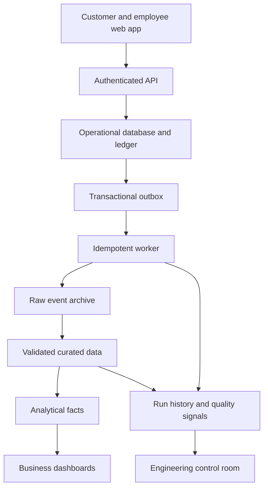

# Handoff: build the banking platform in a separate repository

Owner: **Subhanjan Das**. Starting point: Banking Model Atlas application **1.2.0**, model **0.5.0**. This document is a project brief, not a claim that the platform below exists.

## Keep the two projects distinct

**Atlas** explains the bank's data: interactive model, definitions, relationships, scenarios, validation and a local engineering lab. It remains independently useful and deployable on GitHub Pages.

**The new platform** should let someone use a fictional bank and inspect what happens behind it. It needs a persistent backend, trusted sessions, authorization, transaction processing, workers and analytical models. GitHub Pages alone cannot provide those capabilities.

Start a new chat for the new repository. A new chat does not automatically receive this conversation, even with the same model. Provide this document and `NEW_CHAT_PROMPT.md`, then give it access to the repository. Files and passing tests are the source of truth; chat recollection is not.

Before copying anything, record the exact Atlas commit SHA containing this handoff in the new repo's `docs/ATLAS_PROVENANCE.md`. Import only selected model definitions, fixtures and relevant tests, preserving the Atlas MIT license. Do not fork all screenshots, build outputs and local tooling unless needed. Use a small mapping file from Atlas entity IDs to platform tables so the two models can evolve deliberately.

## What already exists and can be reused

| Asset | Location | Reuse decision |
|---|---|---|
| Rich operational reference | `model/banking.model.json` | Select required domains; preserve grain, keys and business explanations |
| Payment/account/card lifecycle rules | `model/lifecycle_transitions.json` | Reimplement transitions behind backend commands, with tests |
| Ledger invariants | `scripts/reconcile_ledger.py`, `model/validation_checks.json` | Port accounting assertions to the service database; do not treat the fixture as a payment processor |
| Synthetic records | `fixtures/banking_scenarios.json` | Use deterministic seeds, then extend into a workload generator |
| Source-contract and correction examples | `fixtures/ingestion/`, `scripts/ingest_returns.py` | Carry over independent producer controls, version identity and correction semantics |
| Durable reference pipeline | `engineering/pipeline.py`, `tests/test_engineering.py` | Use guarantees and failure tests as specifications; do not expose the local role selector as web authentication |
| Explorer design | `src/`, `docs/assets/` | Reuse the calm light/Dusk visual direction and deep links; credit the source |

Atlas has 81 entities in 16 domains, 130 relationships, 459 columns and ten journeys. Its 207 synthetic model records cover 74 tables. Seven remain schema-only. The operational replay has 27 SQL checks and opening-to-closing reconciliation. The newer SQLite lab is deliberately limited to outbound instruction activity and versioned partial returns. It does not add 81 persistent operational services.

Read `README.md`, `docs/ENGINEERING_LAB.md`, `docs/VALIDATION_COVERAGE.md`, `docs/INTERVIEW_GUIDE.md` and the workflow files before planning changes.

## Product idea

A **fictional banking operations and data platform** with a polished web app and a visible engineering control room. The distinguishing feature is a traceable journey: every simulated customer action has an operational outcome, an audit trail, a pipeline run and a reconciled analytical result.

Start with one coherent journey: a customer initiates a payment; an employee sees its lifecycle; a simulated return arrives in two installments; a late correction updates analytics; an engineer can explain the changed partition and demonstrate recovery after a worker crash.

Use synthetic identities and simulated funds throughout. No connections to real payment rails, actual credit decisions or personal banking credentials are needed for a strong portfolio.

## Decisions to settle before implementation

1. **Bank geography:** Atlas is Canadian. “NRI” is an India-specific product context. Decide whether the new project is an Indian fictional bank with separate product definitions, or a Canadian bank with a non-resident/cross-border persona. Do not silently relabel Canadian products as NRI accounts or claim regulatory compliance.
2. **Deployment and budget:** set a monthly ceiling and choose a single primary cloud/provider after checking current prices and deployment constraints. Keep a complete local Docker Compose path. Any paid resource needs an explicit deployment decision.
3. **First release:** approve the payment journey and customer/operations/engineering roles before adding every persona. Propose a repository name such as `banking-data-platform`; confirm availability and the user's choice before creation.

## Proposed architecture

This is an initial engineering recommendation, not a fixed shopping list. Verify supported versions and hosting choices at implementation time.

- **React and TypeScript web app:** customer workspace, operations console and analytics views, responsive and accessible, with clear synthetic-demo labels.
- **Python API and PostgreSQL:** server-side business commands, immutable balanced ledger postings, idempotency keys, state-transition validation, row ownership and audit events. Do not let UI fields choose the authenticated user's identity.
- **Transactional outbox and worker:** save business state and an outbox event together. Publish events with retries; make consumers idempotent. Begin with a durable polling worker. Add a broker/CDC only when demonstrating that boundary adds value.
- **Raw event archive and analytical transformations:** append raw versioned envelopes, validate contracts, curate deduplicated/current state, then build daily financial and operational facts. Preserve event time and receipt time. Use an initial local DuckDB/dbt analytical path or PostgreSQL analytics schema; choose one in an architecture decision record.
- **Orchestration:** scheduled jobs with run IDs, retries, completeness controls and bounded backfill. Introduce Airflow or another orchestrator when dependencies justify it, not for a single cron command.
- **Observability:** structured logs, trace/correlation IDs, metrics, data-quality outcomes and a pipeline health screen. Every dashboard shows its last successful refresh and source cutoff.
- **Deployment:** frontend plus backend service, managed database or persistent volume, background worker, migrations, secrets, backup/restore and automated smoke checks. A preview deployment must have a working API, not only localStorage state.

PostgreSQL row policies are an option for defense in depth, but table owners and privileged roles can bypass policies. Test using the actual application role, not an administrator. dbt incremental models are an option for transformations; unique keys and filtering strategy must match correction semantics. Primary references: [PostgreSQL row security](https://www.postgresql.org/docs/current/ddl-rowsecurity.html), [dbt incremental models](https://docs.getdbt.com/docs/build/incremental-models).

## Build in acceptance-driven releases

| Release | Working slice | Acceptance evidence |
|---|---|---|
| 0. Foundation | Repository, architecture decisions, local services, migrations, deterministic seed, CI | A fresh clone starts with documented commands; health checks pass; no credentials in source |
| 1. Customer payment | Session, owned accounts, simulated transfer, ledger and transaction history | Cross-customer access denied; concurrent duplicate requests create one effect; postings balance; invalid transition rejected |
| 2. Operations | Payment queue, partial return, case handling, maker/checker approval | Initiator cannot approve own action; terminal-state edits fail; every command has audit and correlation IDs |
| 3. End-to-end data | Outbox, raw events, current projections, daily marts and lineage | Crash/restart, duplicated/out-of-order events, missing source controls, late corrections and replay all tested |
| 4. Analytics and engineering | Customer spending, payment operations, reconciliation, pipeline health | Metrics reconcile to sources; freshness visible; backfill preview and run history; dashboard data comes from API |
| 5. Loans and business banking | Application/decision simulation, repayment allocation, organization roles, payment approvals | Principal/interest allocation reconciles; organization isolation; limits and approval separation tested |
| 6. Non-resident/cross-border | Product eligibility simulation, FX quote expiry, remittance fees and status | Geography explicitly chosen; currency-aware amounts; quote/version provenance; no invented regulatory claims |
| 7. Portfolio release | Threat model, restore drill, load test, demo script, screenshots, architecture tour | Public app smoke test; measured workload and costs; known limits; easy reviewer walkthrough |

Later possibilities: effective-dated customer segments, loan arrears aging, merchant settlement, fraud rule explanations, reconciliation exception workflow and contract lineage. Each should connect to a real user task and an explicit metric. An AI assistant is optional and comes after reliable APIs; it must not bypass authorization or freely generate write SQL.

## Persona boundaries

| Persona | Main experience | Access boundary |
|---|---|---|
| Individual customer | Accounts, payment history, simulated transfer, loan status | Own records only |
| Business maker / approver | Organization accounts, bulk payment preview, approval queue | Organization membership; maker cannot approve own request |
| Operations employee | Scoped cases, payment lifecycle, return handling | Role + branch/team scope; no unlimited customer browse by default |
| Analyst | Portfolio trends, loan and payment performance | Approved aggregates or masked datasets |
| Data engineer | Pipeline runs, completeness, backfills, lineage | Operational metadata; raw access explicitly controlled |
| Non-resident customer | Relevant account/remittance journey after geography decision | Same ownership controls plus explicit product eligibility rules |

## Reference project review

The user supplied [Shruti Mokhashi's Banking Data Platform](https://github.com/ShrutiMokhashi34/Banking_Data_Platform) and its [public app](https://bankingdataplatform.web.app/). Its README describes Azure storage, Databricks medallion layers, Snowflake, Airflow, BigQuery, Google ADK and role-aware customer/employee access. The repository tree includes ingestion scripts, SQL models, app code and screenshots. This is useful architectural inspiration; it is not a reason to duplicate every service.

Review scope: README and repository tree, not a full security audit. The live URL could not be retrieved by the research tool in this session, so interactive behavior was not independently verified. No project-level license was found in the inspected tree; dependency licenses do not grant rights to copy the author's app. Write our implementation independently and acknowledge the inspiration rather than copying code or datasets without permission.

## Keep progress portable

In the new repository, maintain `docs/PROJECT_STATE.md` with current commit, running URLs, commands, migrations, test evidence, decisions, known limitations and the next acceptance gate. Update it at each checkpoint. A later chat needs that file, the repo URL and the task—not the entire historical conversation.
